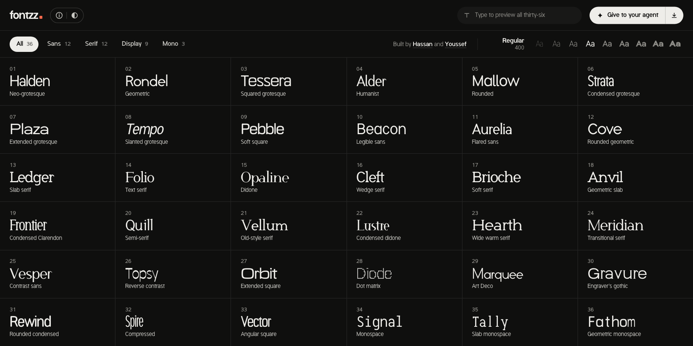

  

<h1 align="center">fontzz</h1>

Thirty original type families drawn entirely in code, every weight from 100 to 900, free under the OFL, with a site to try them and hand them to your agent. <a href="https://fontzz.vercel.app">fontzz.vercel.app</a>

## Tech stack

- Python generator in `type/`: every glyph is parametric, three masters (Thin, Regular, Black) per family, no font editor involved
- fontmake builds the variable font, fontTools and skia-pathops cut the nine static weights, kerning comes from glyph side profiles
- 285 characters per family (Latin-1, Latin Extended-A subset, figures, currency, arrows), WOFF2 at 9 to 37 KB
- Every TTF and WOFF2 passes OTS, the sanitizer Chrome and Firefox run on web fonts
- `site/`: Vite 5, React 18, TypeScript and plain CSS, no UI library, about 62 KB of gzipped JS

## Cloning & running

1. Grab every family (6 MB, variable TTF, nine static TTFs and WOFF2 each): `curl -LO https://github.com/Luffixos/fontzz/raw/main/site/public/downloads/fontzz-all.zip`
2. Clone: `git clone https://github.com/Luffixos/fontzz.git && cd fontzz`
3. Run the site: `npm --prefix site install && npm --prefix site run dev`, then open http://localhost:5178
4. Set up the generator: `python3 -m venv .venv && .venv/bin/pip install -r type/requirements.txt`
5. Rebuild every family into `site/public`: `cd type && ../.venv/bin/python release.py`
6. Rebuild one family while drawing: `../.venv/bin/python release.py halden`, then proof it with `../.venv/bin/python cmp.py out/cmp.png 400`

## Roadmap

- [ ] add stencil and inline display families
- [ ] hint the statics so small sizes on Windows look as crisp as the variable font
- [ ] add italics, starting with Halden and Folio
- [ ] add code ligatures and a slashed zero to Signal and Tally
- Cyrillic and Greek are skipped for now: I'd rather finish Latin properly than ship three half-done scripts.

## License

The fonts and the generator are released under the SIL Open Font License 1.1, so they're free for personal and commercial use but can't be sold on their own. Every download includes `OFL.txt` and the full text is in [LICENSE](LICENSE).

Built by [Hassan](https://x.com/nutlope) and [Youssef](https://x.com/YoussefUIUX).
